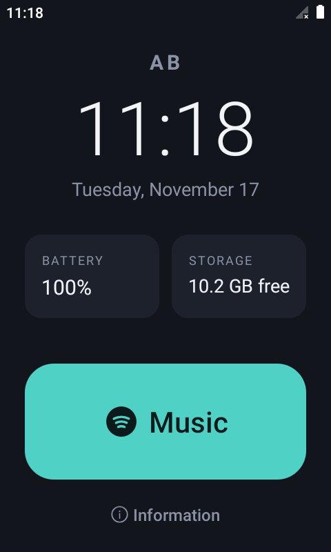
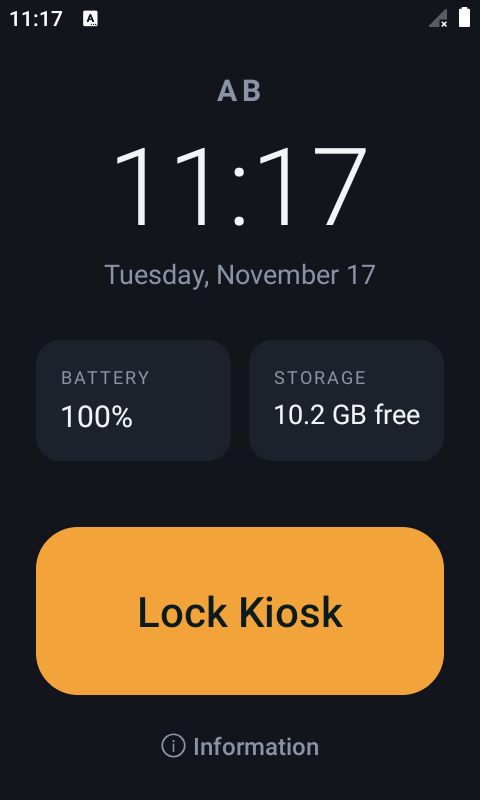
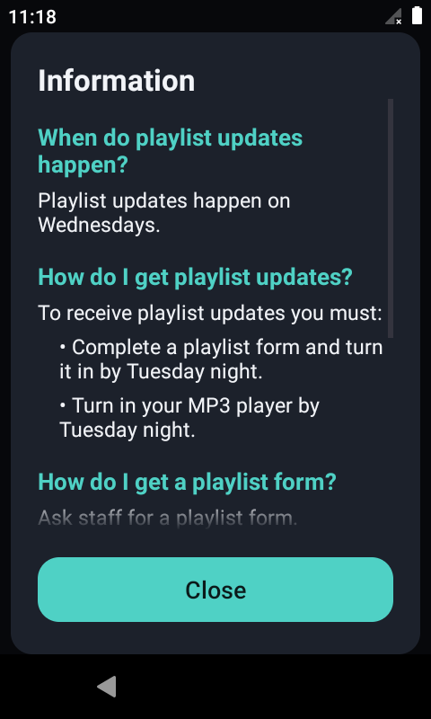
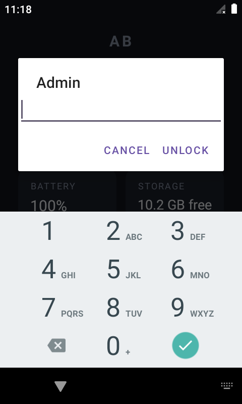

# MP3 Kiosk

An Android kiosk application that locks a device down to a single-purpose Spotify music player. Intended for institutional or residential settings where residents need access to music but the device must remain under staff control.

For the background and design decisions behind this project, read the [case study on my portfolio](https://cameronbibb.com/work/mp3-fleet-manager/).

<p align="center">
  
  
  
  
</p>
---

## What It Does

When provisioned and enabled, the app:

- Presents a full-screen kiosk home screen showing a clock, date, battery status, and available storage
- Launches Spotify as the only accessible application
- Prevents the user from leaving the kiosk (back button suppressed, home screen locked, navigation bar hidden)
- Hides 90+ system and third-party apps that could be used to escape the kiosk or reconfigure the device
- Applies device-wide restrictions (factory reset, Wi-Fi, Bluetooth, app installation, etc.)
- Displays an optional client identifier set by staff
- Accepts remote control commands via authenticated ADB broadcast

Staff can unlock the kiosk by tapping the admin zone 7 times in 5 seconds, then entering the PIN. A brute-force lockout applies after repeated failures (exponential backoff starting at 15 minutes, capped at 24 hours).

---

## Requirements

- **Android 9 (API 28) or higher** — minSdk is 28; tested primarily on Android 9 and Android 14
- **Device Owner provisioning** — the app must be set as Device Owner before kiosk features are available; without it, most policy calls are no-ops and the UI shows "Device not provisioned."
- **Spotify installed** — the kiosk home screen launches `com.spotify.music`; that package must be present on the device

---

## Build Setup

### 1. Create `keystore.properties`

Create a file named `keystore.properties` in the project root (next to `settings.gradle.kts`). The build reads one property from it:

```properties
KIOSK_TOKEN=your_secret_token_here
```

The token is compiled into `BuildConfig.KIOSK_TOKEN` and is required to authenticate every broadcast control command. Keep this file out of version control.

### 2. Build

```bash
./gradlew assembleDebug     # debug APK
./gradlew assembleRelease   # release APK (minification disabled by default)
```

The APK is written to `app/build/outputs/apk/`.

---

## Installing and Provisioning

### Step 1 — Factory reset the device (recommended)

Device Owner provisioning via ADB requires the device to have no accounts and ideally be freshly reset. If accounts exist, the `set-device-owner` command will fail.

### Step 2 — Install the APK

```bash
adb install app/build/outputs/apk/debug/app-debug.apk
```

### Step 3 — Set Device Owner

This must be done **before** any user accounts are added to the device:

```bash
adb shell dpm set-device-owner com.kumh.mp3kiosk/.KioskAdminReceiver
```

A successful response looks like:

```
Success: Device owner set to package com.kumh.mp3kiosk
```

If you see an error about existing accounts, perform a factory reset first.

### Step 4 — Set a PIN

The kiosk cannot be enabled until a PIN is set. Send a broadcast to set it:

```bash
adb shell am broadcast \
  -a com.kumh.mp3kiosk.CONTROL \
  --es token "YOUR_TOKEN" \
  --es action "setPin" \
  --es pin "YOURPIN"
```

PIN must be 4–8 digits, numeric only.

### Step 5 — Enable the kiosk

```bash
adb shell am broadcast \
  -a com.kumh.mp3kiosk.CONTROL \
  --es token "YOUR_TOKEN" \
  --es action "enableKiosk"
```

The device will now be locked down.

---

## Remote Control Actions

All commands are sent as broadcast intents and require the `token` extra to match the value compiled into the build. Replace `YOUR_TOKEN` with the value from `keystore.properties`.

**Base command pattern:**

```bash
adb shell am broadcast \
  -a com.kumh.mp3kiosk.CONTROL \
  --es token "YOUR_TOKEN" \
  --es action "ACTION_NAME" \
  [additional extras]
```

### State

| Action | Description |
|--------|-------------|
| `queryState` | Returns a JSON snapshot of device owner status, kiosk state, active restrictions, PIN status, and lockout state |

### Kiosk Control

| Action | Description |
|--------|-------------|
| `enableKiosk` | Activates kiosk mode — applies restrictions, hides apps, sets persistent home, starts lock task |
| `disableKiosk` | Deactivates kiosk mode — removes temporary restrictions, unhides apps, removes lock task packages |
| `stopLock` | Calls `stopLockTask()` on the foreground activity to exit app-pinning without a full disable |

### PIN and Lockout

| Action | Extras | Description |
|--------|--------|-------------|
| `setPin` | `--es pin "DIGITS"` | Set or change the admin PIN (4–8 digits) |
| `clearLockout` | — | Resets the brute-force PIN lockout counter immediately |

### Restrictions

| Action | Description |
|--------|-------------|
| `restrict` | Applies the permanent user restriction set |
| `clearRestrictions` | Removes all user restrictions set by this app |

### Apps

| Action | Extras | Description |
|--------|--------|-------------|
| `unhideApp` | `--es pkg "com.example.app"` | Makes a hidden package visible again |

### Device

| Action | Extras | Description |
|--------|--------|-------------|
| `setClient` | `--es initials "AB"` | Sets the client identifier shown on the kiosk screen (max 6 uppercase letters); omit `initials` or send empty to clear |
| `setTime` | `--el epoch MS` `--es tz "America/New_York"` | Sets device time (epoch milliseconds) and timezone |
| `clearScreenLock` | — | Removes the device screen lock using the stored reset token (requires token to have been set during provisioning) |
| `clearHome` | — | Removes the persistent preferred home activity setting |
| `wipe` | — | **Factory resets the device.** Uses `wipeDevice()` on Android 14+ and `wipeData()` on earlier versions. Irreversible. |

### Response Codes

The result code returned by the broadcast receiver:

| Code | Meaning |
|------|---------|
| `1` | OK — command succeeded |
| `2` | Error — see logcat (`adb logcat -s KioskAdmin`) |
| `3` | Unauthorized — token did not match |
| `4` | Unknown action |
| `5` | Missing or invalid argument |
| `6` | No PIN set — set a PIN before enabling the kiosk |

---

## Project Structure

```
app/src/main/java/com/kumh/mp3kiosk/
├── MainActivity.kt          # Kiosk home screen UI and lock task management
├── KioskAdminReceiver.kt    # DeviceAdminReceiver — required for Device Owner
├── KioskControlReceiver.kt  # Broadcast receiver for all remote control actions
└── KioskPolicy.kt           # DPM policy logic: restrictions, app hiding, lock task config
```

---

## Logging

```bash
adb logcat -s KioskAdmin
```

All policy changes, control commands, and errors are logged under the `KioskAdmin` tag.
